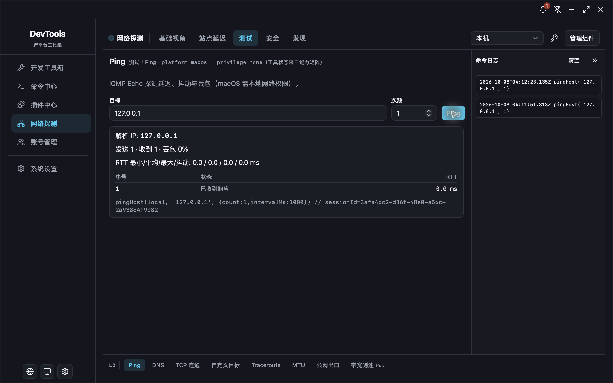

# Desktop Dogfood Report: Bench Network Probe

| Field              | Value                                                                                                                                         |
| ------------------ | --------------------------------------------------------------------------------------------------------------------------------------------- |
| **Date**           | 2026-10-08                                                                                                                                    |
| **App / Version**  | Reproduction: Bench DNS QA 1.37.0 (`com.bench.app.dnsqa20261008`); fix verification: Bench Ping UX QA 1.37.0 (`com.bench.app.pingux20261008`) |
| **OS**             | macOS 27.0.1 (26A434), arm64                                                                                                                  |
| **Locale / Theme** | zh-CN / dark                                                                                                                                  |
| **Scope**          | Network Probe P0-1 Ping result and rerun behavior                                                                                             |

## Summary

| Severity  | Count |
| --------- | ----- |
| Critical  | 0     |
| High      | 0     |
| Medium    | 1     |
| Low       | 0     |
| **Total** | **1** |

## Issues

### ISSUE-001: Successful Ping repeats the raw command and session ID in the result card

| Field           | Value                       |
| --------------- | --------------------------- |
| **Severity**    | medium                      |
| **Category**    | ux                          |
| **Where**       | Network Probe → Test → Ping |
| **Repro Video** | N/A (static/visible issue)  |

**Description**

After a successful local IPv4 Ping, the result card permanently displays the raw `pingHost(...)` invocation, including an internal session UUID. The same command is already present in the command-log sidebar, so this duplicates technical detail and reduces space for the result summary and packet table. This repeated on two separate runs against `127.0.0.1` with one packet.

**Repro Steps**

1. Open Network Probe → Test → Ping.
2. Set the target to `127.0.0.1` and packet count to `1`, then run Ping.
3. Observe the successful summary and packet table, followed by the raw command/session ID in the result card; the command is also in the sidebar log.
4. Run the same probe once more; the raw command remains visible with a new session ID.
   

**Expected**

Keep the normal result card focused on the summary and packet table. Expose raw invocation details only through a collapsed technical-details control or the command-log sidebar.

**Actual**

The raw invocation and internal session ID are always visible in the result card and duplicated in the sidebar.

**Resolution and true-device verification**

- Moved local and Globalping successful command hints into the same default-collapsed technical-details disclosure used for raw diagnostics. The successful summary, packet table, and command-log sidebar remain visible.
- Verified on macOS 27.0.1 (26A434), arm64, using the isolated `Bench Ping UX QA` app. Two one-packet local runs against `127.0.0.1` both returned 1/1 with 0% loss. In zh-CN and English, the result card kept the summary/table visible and the technical details collapsed; expanding it revealed the raw invocation and session ID. The command log retained one concise command per run.
- Ran one anonymous Globalping Worldwide Ping to `example.com`; the result was 1/1 from Falkenstein, DE. Its command stayed collapsed by default and was available after expanding technical details.
- `PingPanel` tests: 15 passed. Network Probe tests: 165 passed. `lint:fe` and Prettier checks passed. The default bundle attempt stopped at updater signing because this machine has no updater private key; rebuilding the QA app with updater artifacts disabled exited 0. The final app launched, passed true-device verification, and exited cleanly.
- Closed the QA app and moved its isolated app data, QA bundle/archive, `dist`, and extension staging output to Trash. The formal Bench app remained closed; only the pre-existing `bench-host` process remained.

**Status: fixed and verified on a real Mac.**

---

## Appendix: Reviewed, not an issue

- The overview capability banner and `getLocalNetworkSummary` label match the product specification and prototype; navigation between Overview, Sites, and back kept the banner consistent.
