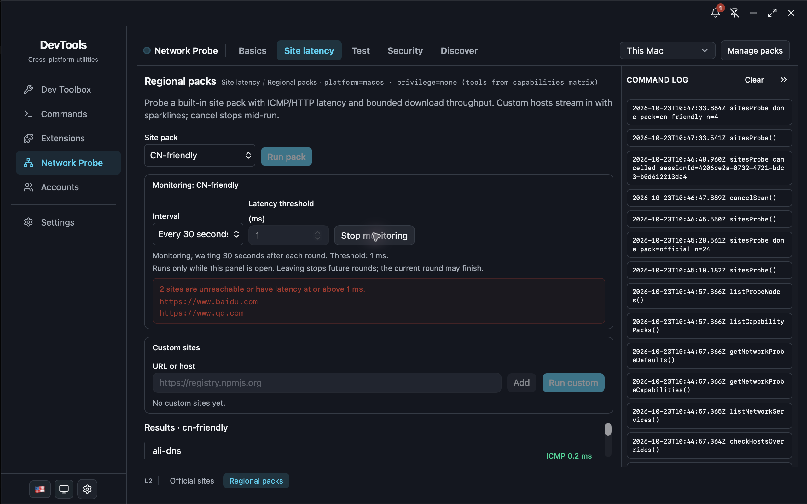

# Desktop Dogfood Report: Bench QA Monitor

| Field              | Value                                                                                                            |
| ------------------ | ---------------------------------------------------------------------------------------------------------------- |
| **Date**           | 2026-10-23                                                                                                       |
| **App / Version**  | Bench QA Monitor 1.37.0                                                                                          |
| **OS**             | macOS 27.0.1, arm64                                                                                              |
| **Locale / Theme** | zh-CN and en-US / dark                                                                                           |
| **Scope**          | Network Probe site monitoring: official sites, built-in site packs, thresholds, cancellation, and page lifecycle |

## Summary

| Severity  | Count |
| --------- | ----- |
| Critical  | 0     |
| High      | 0     |
| Medium    | 0     |
| Low       | 0     |
| **Total** | **0** |

## Issues

No reproducible issues found in this scope.

## Verified scenarios

- Official sites: set 30-second interval and 1 ms threshold; all 24 targets completed, displayed 24 alert targets, and kept the interval and threshold visible while running.
- Page lifecycle: leave the site panel and wait longer than one interval; return to find monitoring stopped and the command log still contained only the initial round.
- Cancellation: stop during an active official-site round; `cancelScan()` ran, the session logged as cancelled, and no next round was scheduled.
- Built-in pack: CN-friendly completed four targets; a second round started only after 30 seconds and completed without overlapping the first.
- Threshold validation: value 0 disabled Start monitoring and showed the supported 1–10000 ms range.
- Locale: monitoring controls, status, alerts, and page navigation displayed in both Chinese and English.
- No security tools, permission prompts, system notifications, or Local Network/TCC changes were used.

## Appendix: Non-reproducible Observations

- None.
